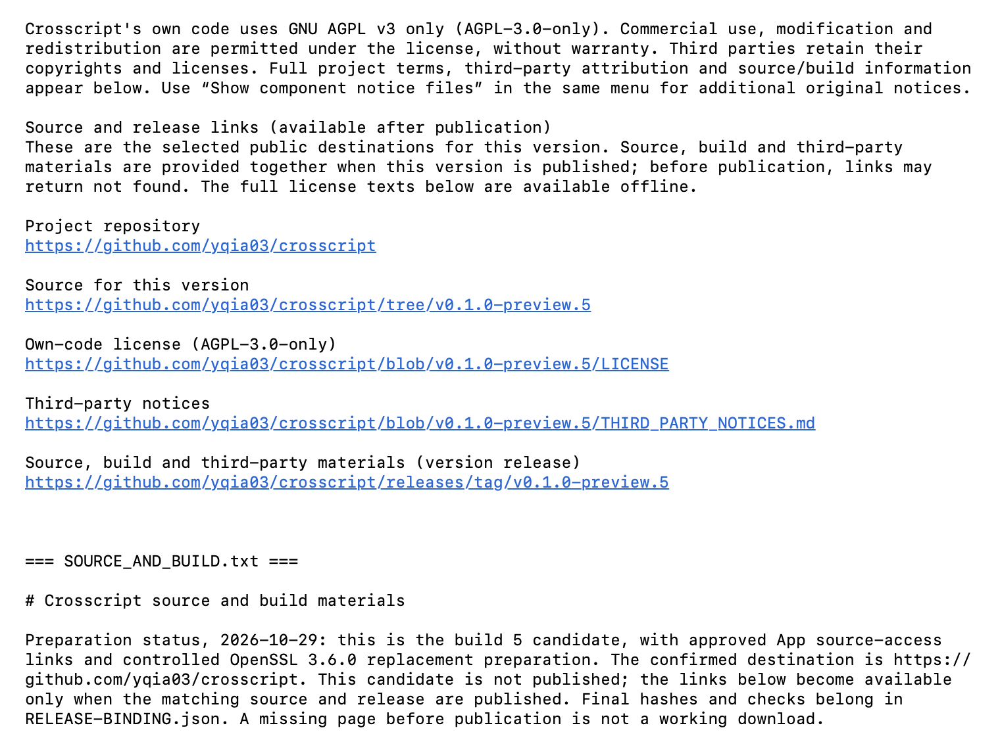
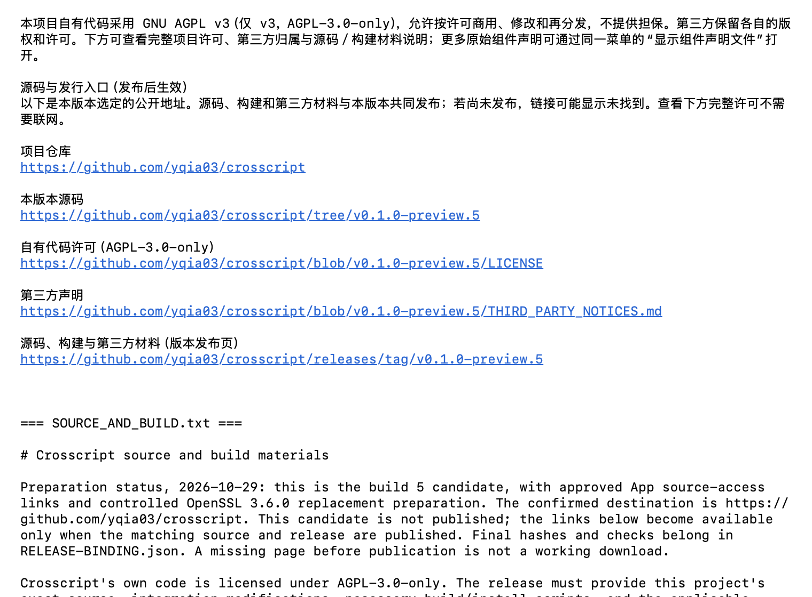

# Build 5 user materials and public entry points

Checked 2026-11-01 for [issue #6](https://github.com/yqia03/crosscript/issues/6). Current user entry points are the [English README](../../../README.md), [中文首页](../../../README.zh-CN.md), [English use guide](../../getting-started.md) and [中文使用说明](../../getting-started.zh-CN.md). The public version is [v0.1.0-preview.5](https://github.com/yqia03/crosscript/releases/tag/v0.1.0-preview.5), App **0.1.0 (5)**.

## Published state and identity

Crosscript is the project/release brand. The frozen App's display name is **翻译工作台**, its file/executable remains `TranslationWorkbench`, and its bundle ID remains `dev.uown.translation-workbench`. This documentation change performs no branding migration, App rebuild or provider run.

The Release records publication approval and an explicit second-Mac waiver on 2026-10-30. **Build 5 B01–B06 were not run.** The waiver is a release decision, not a passing result; build 4 acceptance is not inherited. macOS 14.2 is the declared minimum, without a physical test on that version. Ad-hoc integrity signing provides neither Developer ID publisher authentication nor Apple notarization.

The frozen tag/source archive/App/28 assets retain their original 2026-10-29 preparation wording, including publication-pending links. The current Release supplies the later decision. Development-branch READMEs and use guides now describe the actual release. Historical banners on `docs/source-and-build.md`, `docs/distribution-materials.md` and `docs/release-preparation.md` preserve the earlier text while directing readers here. Those documentation files are build inputs: changes here apply to a future build and do not change build 5's signed resources or source binding.

## Repository, support and security

The root verification observed these public repository settings at 2026-11-01 09:38:53 UTC; the exact snapshot is in [user-materials-verification.json](user-materials-verification.json).

| Entry | Observed value / action |
| --- | --- |
| Repository | [yqia03/crosscript](https://github.com/yqia03/crosscript), public, Issues enabled |
| About | Apple Silicon translation workbench for text, PDFs, recordings and live bilingual captions. AGPL-3.0-only. |
| Homepage | [Build 5 Release](https://github.com/yqia03/crosscript/releases/tag/v0.1.0-preview.5) |
| Topics | `apple-silicon`, `babeldoc`, `gemini`, `macos`, `pdf`, `swift`, `swiftui`, `transcription`, `translation` |
| Help / bugs | [New issue](https://github.com/yqia03/crosscript/issues/new), sanitized steps and version/workflow/provider details; [contribution guidance](../../../CONTRIBUTING.md) |
| Vulnerabilities | [Private report](https://github.com/yqia03/crosscript/security/advisories/new), enabled via repository settings; [SECURITY.md](../../../SECURITY.md) |

No advisory or support message was submitted to test these destinations. Ordinary support is best effort; no deadline or fix guarantee is added. Both READMEs, both guides and contribution/security documents link these same destinations.

Root observations at 09:31 UTC used unauthenticated HTTPS GETs: all five signed-App link targets, Issues and the existing contribution page returned HTTP 200. All 28 release assets were downloaded anonymously and matched their release sizes/hashes. These are recipient-access observations, not installation or provider results. The five hosted ASCII documentation filenames map to original Chinese manifest filenames as documented in the Release; the guides do not tell users to run the complete checksum manifest against unmapped names. The three main archives remain the exact preview, exact App-bound source and full third-party companion from that Release; generated GitHub source archives are not substituted.

## Screenshot scope and privacy review

Existing `run-final-normal/images/en-default-top.png` and `zh-default-top.png` were visually inspected. They show the actual build 5 license component and real language module in an isolated helper: readable bilingual license text and five public links, with the earlier publication-pending wording visible. There is no private body text, API key, username or machine path in the visible captures. The [released LICENSE-UI-VERIFICATION.json](https://github.com/yqia03/crosscript/releases/download/v0.1.0-preview.5/LICENSE-UI-VERIFICATION.json) binds that historical run to the component/language and frozen document hashes, and explicitly limits it to an isolated component.

The review is **not** a production App screenshot, full App launch, installation demonstration or any of the four workflows running. No replacement full-App screenshots or cloud outputs were fabricated. The current development-branch historical banner is not retroactively shown in the captured component.

Two lossless metadata-sanitized derivatives are included below. Original/output PNG SHA-256 values and decoded-pixel hashes are in [user-materials-verification.json](user-materials-verification.json). Incidental EXIF was removed; the ICC profile's device-identifying `mmod` payload was zeroed and its profile ID cleared (already zero in the input). Every other ICC byte/tag payload, including all color-transform data, is unchanged. PNG compressed image data and decoded RGBA pixels compare exactly with the originals. The final images were visually inspected again. These are metadata-cleaned historical captures, not new captures; they retain the old visible publication wording.

English isolated license component, build 5 source (not full App):

中文隔离许可组件，匹配 build 5 源码（不是完整应用）：

## Redistributable sample audit

The retained [synthetic-one-page.pdf](../../../tests/fixtures/pdf/synthetic-one-page.pdf) is 745 bytes, SHA-256 `02f4f326897d1e154b5d527bf6e6edf8eea1bfd657d41b5dad388a37697a30cd`. It was authored for release preparation on 2026-10-26 and its [README](../../../tests/fixtures/pdf/README.md) and [standard-library generator](../../../scripts/pdf/generate_synthetic_fixture.py) state AGPL-3.0-only.

The generator was run to a fresh temporary path and produced byte-identical content. The PDF contains three original test sentences, one base Helvetica reference and no author/embedded metadata, imported image, font payload or attached file. No user document, private historical sample or external text is used. This is a provenance/reproducibility check, not a real BabelDOC rendering/translation acceptance result. No new PDF sample, recording or provider result is claimed.

## User-guide coverage and open verification limits

Both language versions cover actual downloads and digest checks, normal Finder installation, per-app first-open limitations, own-key service setup, local data versus cloud processing, provider charges, the PDF bundle/download split, history and export, uninstall/data/keychain scope, help and security reporting. Manifest inspection reconfirmed **267 inputs: 22 bundled and 245 HTTPS inputs totaling 359,471,768 bytes**. Users are told to reserve additional install/work space and use the managed environment rather than transplanting caches.

| Workflow | Public statement retained |
| --- | --- |
| Text / Markdown | Existing implementation/scoped historical checks; no fresh cloud acceptance or universal provider/model/language claim; explicit submissions and history restoration are distinguished. |
| PDF | Focused offline component/install/reuse evidence; earlier partially completed PDF batch remains stopped; arbitrary layout, scanned-image OCR and cold downloads on another Mac are not established. |
| Recording / transcription | AiHubMix historical real-use evidence; official OpenAI success and all preset timestamp behavior remain unverified; fixed audio presets are not arbitrary compatible endpoints. |
| Gemini Live | Short historical real-service checks; long sessions, real reconnection and real file-gap repair retain gaps; no real file-repair success, translated-speech or latency guarantee. |
| Installation / whole App | Build 5 second-Mac B01–B06 not run/waived; macOS 14.2 physical testing, full workflow acceptance, real cold download and uninstall/secure-erasure behavior are not claimed. |

The documentation acceptance is scoped to accurate public entry points, guide coverage and safe existing materials. It does not close the technical installation/provider gaps above. No production source, frozen asset or signature changed. No live/paid probe, stopped PDF batch, production App launch, Keychain access, permissions change or uninstall was performed. Broader compatibility evidence requires its own approved future verification; changes to signed content require a new build.

## Checks performed

- Read the published Release and original installation/license-UI evidence, then compared maintained EN/ZH wording against those facts.
- Checked frozen `LicenseNotices.swift`, `AppLanguage.swift`, `LICENSE` and `THIRD_PARTY_NOTICES.md` hashes against `LICENSE-UI-VERIFICATION.json`; all match. The older bundled source/build document is intentionally historical and differs from the new development-branch annotation.
- Visually reviewed the two existing license captures and audited PNG chunk/metadata scope; disposition is explicit in the JSON record.
- Regenerated the original synthetic PDF to a temporary path and compared exact bytes; inspected its structure and original provenance declaration.
- Counted current manifest inputs and HTTPS payload bytes; checked relative Markdown targets, JSON parsing, privacy strings and `git diff --check`.

This is a documentation/evidence change. No new behavior tests or red/green claim were needed; no App rebuild or broad suite was run. Available source, notices and build materials remain distinct from proof of every native original build or a blanket license/legal conclusion.
