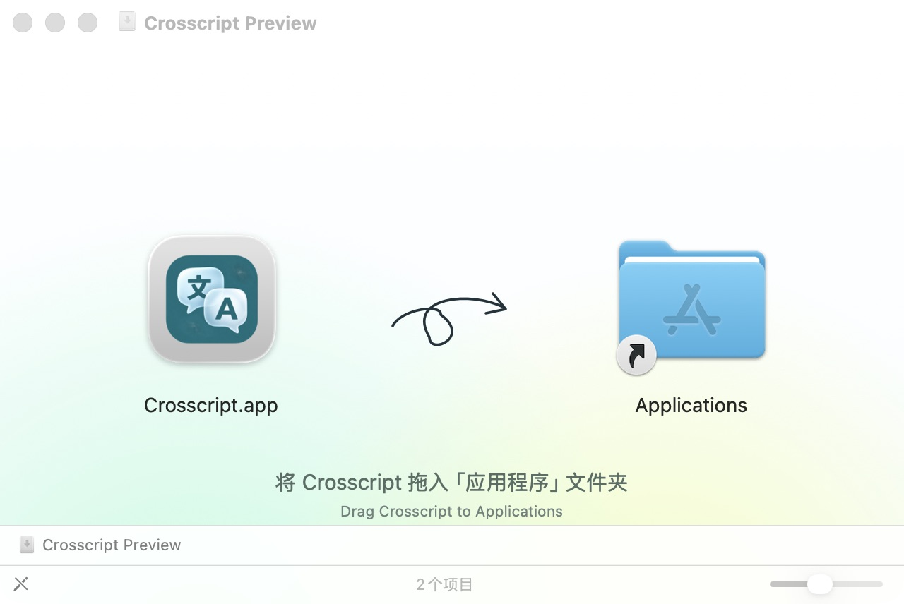
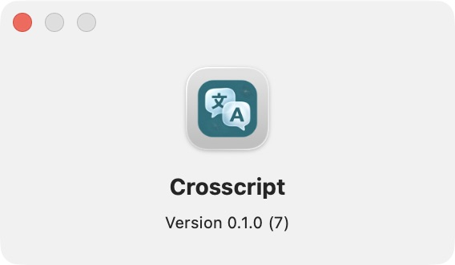

# Build 7: Crosscript naming and drag-to-Applications layout

## Public delivery — 2026-11-02

PR [#20](https://github.com/yqia03/crosscript/pull/20) is merged and [v0.1.0-preview.7](https://github.com/yqia03/crosscript/releases/tag/v0.1.0-preview.7) is published as a prerelease. Its three assets match the final local byte sizes and SHA-256 values; all three public download URLs respond successfully. The tag points to the App's exact source commit `4579cac20caafdd4dc716def209cb21b8b100a66`. See [public delivery verification](public-delivery.json).

The build 5 and build 6 Release bodies, identities and asset IDs, filenames, byte sizes, digests and URLs were compared before and after publication and remain unchanged. This publication adds no ordinary-Mac or cloud-workflow acceptance. The following preparation record and the corresponding frozen material archive describe their earlier local stage; their “candidate” and “not published” wording does not override the published Release status.

## Preserved preparation record

**Workflow supplement:** after #15 closed, 118 selected Swift test functions and four Python language checks passed in a fresh Release test build using the same App source as this candidate. Seven AppKit functions ran in separate processes. The managed-runtime-dependent check was omitted, and no cloud requests, physical capture or real Keychain operations occurred. See the [focused results and exclusions](workflow-offline-checks.md). These checks advance #16/#17; they do not close the remaining real-service or ordinary-environment conditions.

**Post-publication supplement (2026-11-02):** an actual Finder drag from the read-only published DMG's App icon onto its Applications icon subsequently completed. The destination was absent before the gesture. Its full App tree and strict signature matched, the exact installed executable launched with networking denied and fresh synthetic legacy data, and About showed Crosscript 0.1.0 (7). Normal exit, moving the test copy back to test storage, verifying the pre-existing old App unchanged and unmounting only the task's DMG all passed. See [drag-install results](drag-install.json) and the [installed About screenshot](drag-installed-about.png). This closes the earlier drag-gesture evidence gap on the build Mac; ordinary-Mac first open, real TCC/Keychain and cloud acceptance remain untested. The earlier failed gesture and Copy/Paste results below remain historical observations.

This is development work for [brand consistency #13](https://github.com/yqia03/crosscript/issues/13) and [DMG presentation #14](https://github.com/yqia03/crosscript/issues/14), under the approved [exit-preview specification #12](https://github.com/yqia03/crosscript/issues/12). It is not a stable-release acceptance or a publication record. The published build 5 and build 6 packages, tags and historical evidence remain unchanged.

The new candidate is `0.1.0 (7)`. Its App filename, packaged executable, bundle name/display name, main window, menu-bar quit action and product footer use **Crosscript**. The Swift package/module name, bundle identifier, data directories, preferences and Keychain services keep their existing identities. The current download guides distinguish the unchanged build 6 package from the new candidate. Upgrade instructions require quitting the old App and removing only its App bundle, preserving stored materials and credentials; macOS privacy-authorization reuse is not promised.

The DMG presents the real App and Applications link on a light blue/mint/yellow background with a looped arrow and bilingual drag instructions. Packaging retains full App, payload, signature and ZIP/DMG comparison checks. External notices remain available in the hidden `.release-info` directory, the App license window and complete materials.

## Verification scope

The final local candidate was built offline from clean commit `4579cac20caafdd4dc716def209cb21b8b100a66`; the signed App records that revision and source archive SHA-256 `9715aa1dd0825123e3f4a07685c653238f6a04de9cb93de8088535c275d2579a`. The GitHub noreply commit-identity correction preserved the exact source tree/archive; the 62 tests were reused for identical code, and this final build, package, Finder and isolated-App checks were executed again. Later evidence commits do not change that build input. See [candidate digests and results](verification.json).

- 33 packaging tests, including actual standard/Retina background raster checks, and 18 archive-assembly tests passed. Eleven existing migration/configuration/credential-boundary tests passed using temporary files and fake credentials.
- The final DMG passed creation, compressed-image verification, read-only mounting, full payload/App copy comparison, strict ad-hoc signature checks and unmounting. The ZIP independently extracted to the same complete App tree. File bytes, paths, modes and directories are compared; extended attributes are outside that digest.
- Actual Finder inspection and a second mount at a different path showed the real App, Applications link, gradient, loop arrow and complete bilingual instructions. On this macOS 26.6.2 host, global Finder preferences kept the path/status bars visible despite saved defaults; the 340-point safe area keeps the instructions readable without changing those preferences. See [visual observations](finder-visual.json) and the screenshot below.
- The copied final App launched and quit normally with outbound networking denied. It migrated a synthetic legacy schema-1 text workspace to schema 3, kept both edited translations and two history entries, and restored an older result without a new request. Original legacy material and provider-configuration files remained byte-identical. Window, menu, footer, executable/process and About names were checked; About showed Crosscript 0.1.0 (7). See [App and upgrade observations](app-ui-and-upgrade.json).
- All 59 Core source files and the existing credential adapters remain identical to the pre-branding baseline. The packaged PDF resources/pins match build 6 byte-for-byte, so the unchanged original build 5 third-party companion remains applicable; historical component tests were not rerun.
- The three local deliverables were copied and checked against their [final sizes/digests](local-delivery.json). A streaming [complete-materials roundtrip](materials-roundtrip.json) verified all 32 members, nested archive digests and internal checksums. They remain local candidates; PR [#20](https://github.com/yqia03/crosscript/pull/20) contains the implementation and review evidence.

The original smoke check used an isolated copy destination. A later user-approved check installed the same App into `/Applications/Crosscript.app` using Finder Copy/Paste through the DMG’s Applications link. The drag gesture automation did not produce a copy, so actual dragging is not marked passed. The installed executable launched with outbound networking denied and fresh synthetic legacy data, restored both edited results and history, then quit normally. Its complete tree and strict signature matched before and after moving it back to the test output; the pre-existing `TranslationWorkbench.app` stayed byte-identical. See [installation and cleanup](applications-install.json) and the [installed About panel](installed-about.png). Ordinary-Mac first installation, Gatekeeper, real Keychain/TCC migration, minimum-OS compatibility, cloud workflows and broader exit-preview criteria remain outside this result. Preliminary builds and failed layout experiments are not substituted for final evidence. No new release, tag or public binary has been published by this record.

No private recordings, actual provider credentials or paid/cloud probes are used for this branding and packaging change. Existing acceptance and waivers remain scoped to their recorded versions. Tasks [#15–#19](https://github.com/yqia03/crosscript/issues/15) separately govern support evidence, workflow acceptance and the final exit-preview decision.
